# T17. Administració Electrònica a Catalunya i Expedient Electrònic

## 🎯 Objectiu del tema

Entendre:

1. La regulació catalana de l'administració electrònica.
2. Les finalitats i principis de la **Llei 29/2010**.
3. El model d'**Administració digital de la Generalitat** (Decret 76/2020).
4. L'**expedient electrònic** (art. 70 Llei 39/2015).
5. L'**arxiu electrònic** (art. 17 Llei 39/2015).

---

# 1. Marc normatiu

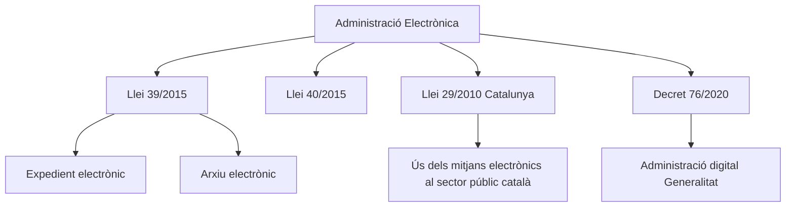

---

# 2. Llei 29/2010

## Què és?

Llei catalana que regula l'ús dels mitjans electrònics al sector públic de Catalunya.

## Finalitats

### Fàcil de memoritzar: "5E"

| E | Finalitat |
|---|---|
| Eficiència | Administració més àgil |
| Economia | Menys costos |
| Efectivitat | Millor prestació dels serveis |
| Equitat | Accés per a tota la ciutadania |
| Electrònica | Relacions digitals |

---

## Principis

### Mnemotècnic: "SIICTT"

| Principi | Significat |
|-----------|------------|
| Seguretat | Protecció de dades |
| Interoperabilitat | Sistemes compatibles |
| Igualtat | Mateixos drets |
| Cooperació | Entre administracions |
| Transparència | Accés a la informació |
| Traçabilitat | Seguiment de les actuacions |

---

## Esquema

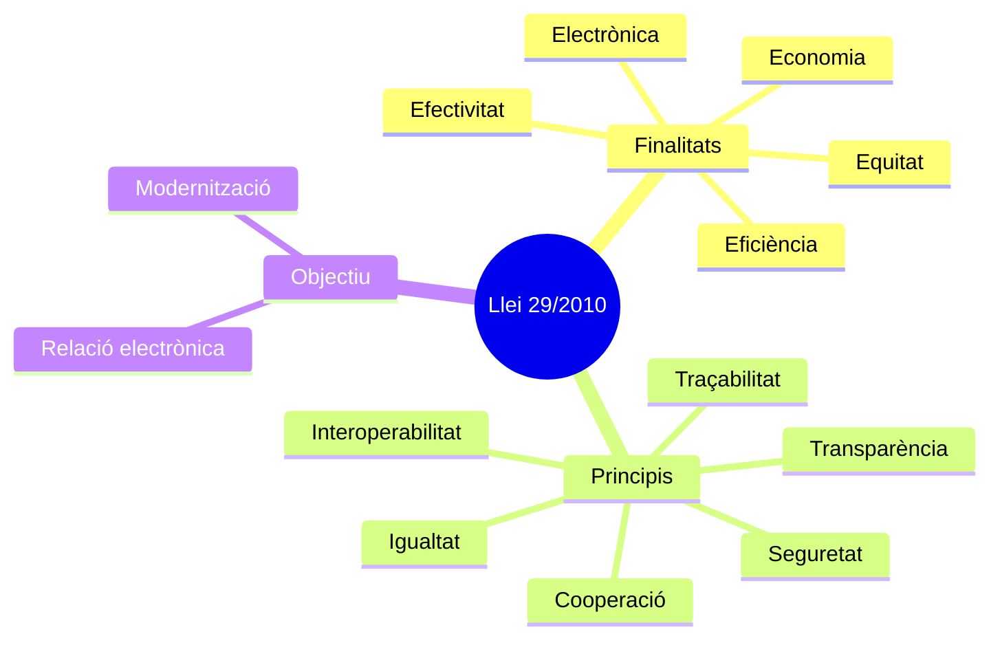

---

# 3. Administració Digital (Decret 76/2020)

## Què regula?

L'organització digital de la Generalitat.

Passa de parlar només de tecnologia a parlar de:

- Governança
- Dades
- Serveis digitals
- Identificació
- Tramitació electrònica

---

## Pilars

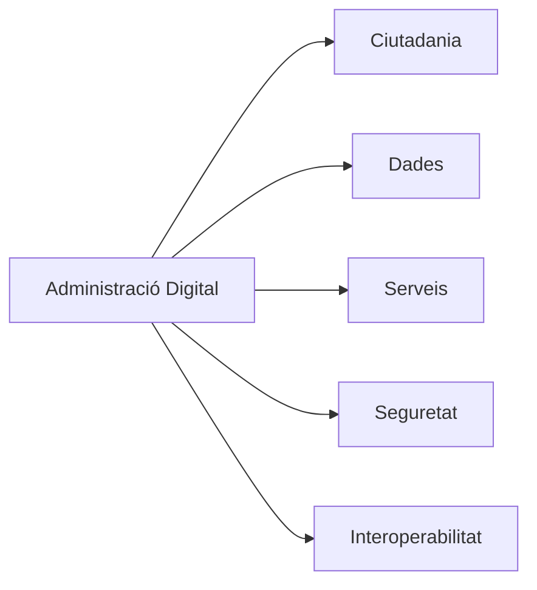

---

## Principis

| Principi | Idea clau |
|-----------|-----------|
| Digital per defecte | El canal preferent és l'electrònic |
| Simplicitat | Menys càrregues |
| Proactivitat | L'Administració s'anticipa |
| Dada única | No demanar dues vegades la mateixa dada |
| Seguretat | Protecció de la informació |
| Accessibilitat | Sense barreres |

---

## Exemple pràctic

❌ Abans

Ciutadà aporta:

- DNI
- Empadronament
- Certificat tributari

✅ Ara

L'Administració consulta aquestes dades per interoperabilitat.

---

# 4. Expedient Electrònic

## Article 70 Llei 39/2015

### Definició

Conjunt ordenat de documents i actuacions corresponents a un procediment administratiu.

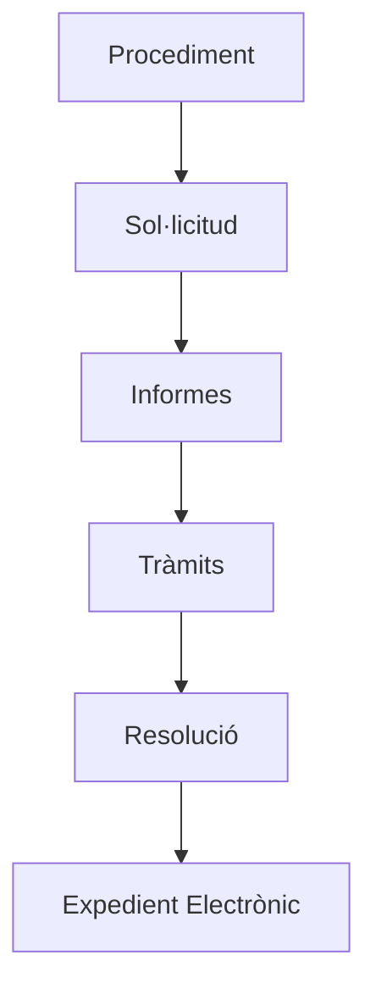

---

# Què integra l'expedient?

## Inclou

✅ Sol·licitud

✅ Documents aportats

✅ Informes

✅ Proves

✅ Tràmits

✅ Resolució

✅ Índex electrònic

---

## NO inclou

❌ Notes internes

❌ Esborranys

❌ Opinions preparatòries

❌ Comunicacions auxiliars

---

## Estructura

```text
EXPEDIENT

├── Índex electrònic
├── Sol·licitud
├── Documentació annexa
├── Informes
├── Requeriments
├── Al·legacions
└── Resolució
```

---

# 5. L'Índex Electrònic

## Què és?

Relació numerada de tots els documents de l'expedient.

## Funcions

### Serveix per:

- Garantir la integritat.
- Evitar manipulacions.
- Ordenar la documentació.
- Facilitar la consulta.

---

## Esquema

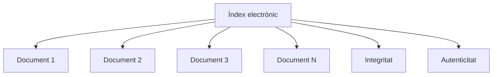

---

## Exemple

| Nº | Document |
|----|-----------|
| 1 | Sol·licitud |
| 2 | DNI |
| 3 | Informe tècnic |
| 4 | Resolució |

---

# 6. Arxiu Electrònic

## Article 17 Llei 39/2015

Les administracions han de mantenir un arxiu electrònic únic dels expedients finalitzats.

---

## Requisits

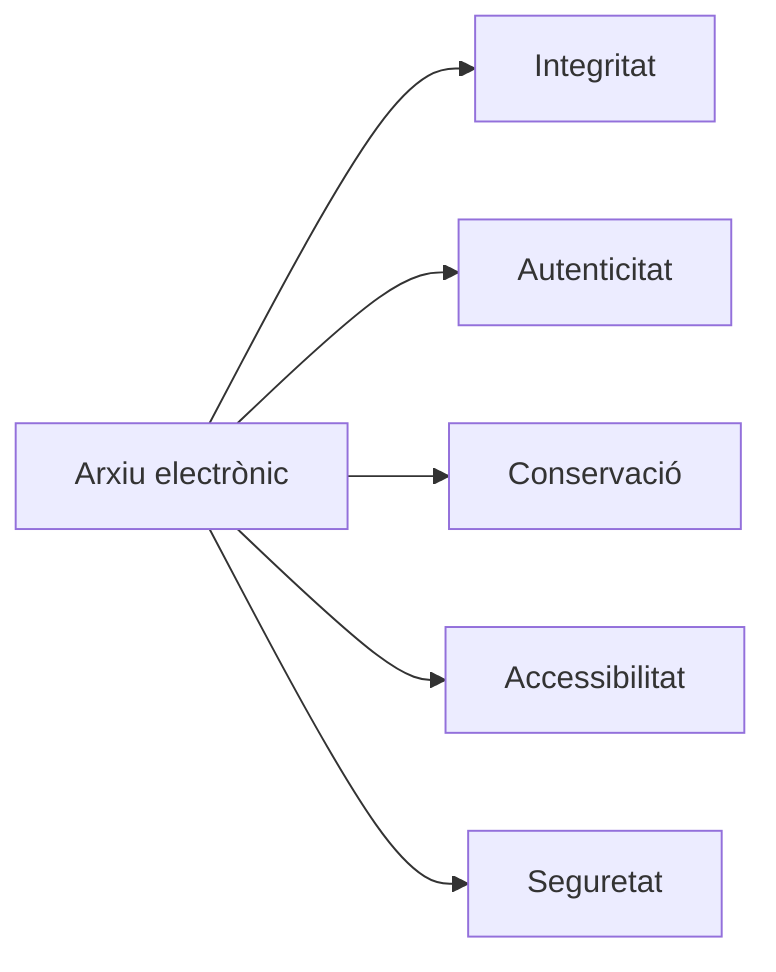

---

## Què garanteix?

| Garantia | Significat |
|-----------|------------|
| Integritat | No modificació |
| Autenticitat | És l'original |
| Conservació | Es manté en el temps |
| Accessibilitat | Es pot consultar |
| Seguretat | Protegit davant riscos |

---

# Expedient vs Arxiu

## Pregunta típica d'examen

| Expedient electrònic | Arxiu electrònic |
|----------------------|-----------------|
| Procediment en curs o finalitzat | Conservació |
| Art. 70 | Art. 17 |
| Documents del procediment | Expedients finalitzats |
| Finalitat de tramitació | Finalitat de custòdia |

---

## Esquema global

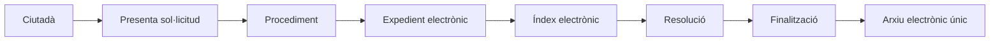

---

# Comparativa normativa

| Norma | Objecte principal |
|---------|------------------|
| Llei 29/2010 | Ús dels mitjans electrònics al sector públic català |
| Decret 76/2020 | Administració digital Generalitat |
| Llei 39/2015 art.70 | Expedient electrònic |
| Llei 39/2015 art.17 | Arxiu electrònic |

---

# Preguntes test freqüents

### 1. Quina norma regula l'expedient electrònic?

✅ Llei 39/2015 (art. 70)

---

### 2. Quina norma regula l'arxiu electrònic?

✅ Llei 39/2015 (art. 17)

---

### 3. L'índex electrònic forma part de l'expedient?

✅ Sí

---

### 4. Les notes internes formen part de l'expedient?

❌ No.

---

### 5. L'arxiu electrònic conserva expedients finalitzats?

✅ Sí.

---

# Resum de 30 segons

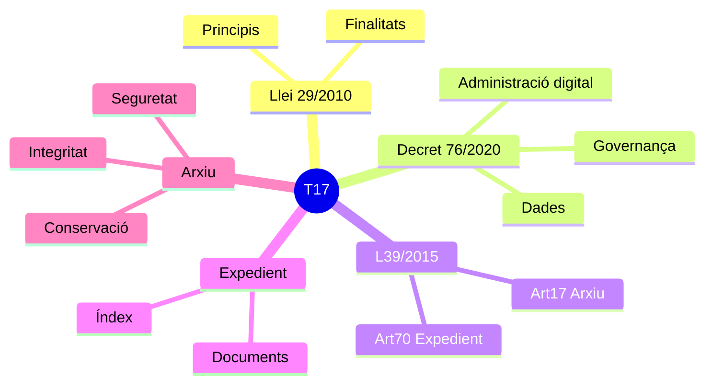

# Frase d'examen

> L'expedient electrònic (art. 70 Llei 39/2015) és el conjunt ordenat de documents i actuacions d'un procediment administratiu, incorporant un índex electrònic que en garanteix la integritat. Un cop finalitzat, s'incorpora a l'arxiu electrònic únic previst a l'article 17 de la mateixa llei. 


# 🧠 Regles mnemotècniques (T17)

## 1. Llei 29/2010: Finalitats

### Les 5 E

```text
Eficiència
Economia
Efectivitat
Equitat
Electrònica
```

Frase:

> Una administració electrònica ha de ser més **Eficient**, més **Econòmica**, més **Efectiva**, més **Equitativa** i plenament **Electrònica**.

---

## 2. Llei 29/2010: Principis

### SIICTT

```text
S = Seguretat
I = Interoperabilitat
I = Igualtat
C = Cooperació
T = Transparència
T = Traçabilitat
```

Frase:

> Sense **Interoperabilitat** i **Igualtat**, la **Cooperació**, la **Transparència** i la **Traçabilitat** no funcionen amb seguretat.

---

## 3. Decret 76/2020: Principis de l'Administració digital

### DSPSA

```text
D = Digital per defecte
S = Simplicitat
P = Proactivitat
S = Seguretat
A = Accessibilitat
```

Frase:

> Una administració moderna ha de ser **Digital, Simple, Proactiva, Segura i Accessible**.

---

## 4. Expedient electrònic (art. 70)

### SIDIR

```text
S = Sol·licitud
I = Informes
D = Documents
I = Índex electrònic
R = Resolució
```

Flux mental:

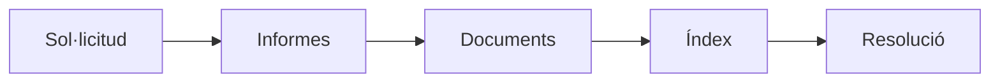

Quan et preguntin què integra un expedient, pensa:

> **SIDIR**

---

## 5. Documents que NO formen part de l'expedient

### NEO

```text
N = Notes internes
E = Esborranys
O = Opinions o documents preparatoris
```

Regla:

> Tot el que sigui **NEO** queda fora de l'expedient electrònic.

---

## 6. Índex electrònic

### IA

```text
I = Integritat
A = Autenticitat
```

Pregunta típica:

> Què garanteix l'índex electrònic?

Resposta:

> **IA = Integritat i Autenticitat**

---

## 7. Arxiu electrònic (art. 17)

### SIACA

```text
S = Seguretat
I = Integritat
A = Autenticitat
C = Conservació
A = Accessibilitat
```

Frase:

> L'arxiu electrònic **SIACA** conserva els expedients de forma segura.

---

## 8. Diferència entre Expedient i Arxiu

### Regla d'or

```text
70 = Treballa
17 = Guarda
```

o bé

```text
Art. 70 → Tramitació
Art. 17 → Conservació
```

Esquema:

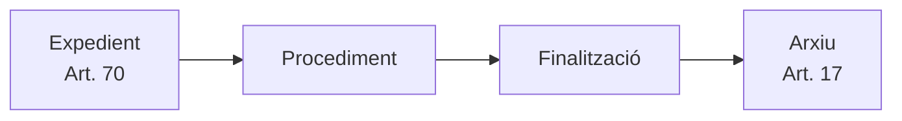

---

## 9. Relació entre totes les normes

### Cadena de memòria

```text
29 → impulsa
76 → desenvolupa
70 → tramita
17 → conserva
```

### Visual

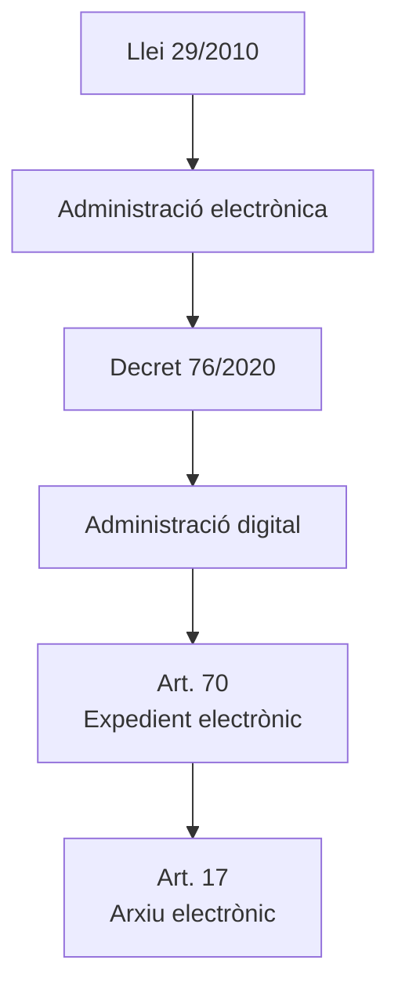

---

## 10. Regla definitiva per a l'examen

### Formula màgica

```text
29 impulsa
76 desenvolupa
70 tramita
17 conserva
```

### Frase completa

> La Llei 29/2010 impulsa l'administració electrònica; el Decret 76/2020 desenvolupa l'administració digital; l'article 70 de la Llei 39/2015 regula l'expedient electrònic i l'article 17 regula l'arxiu electrònic.

---

## 🎯 Super-resum de 20 segons

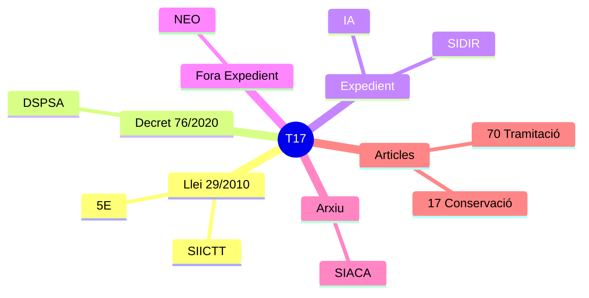

### Acrònims finals

```text
5E      → Finalitats Llei 29/2010
SIICTT  → Principis Llei 29/2010
DSPSA   → Principis Decret 76/2020
SIDIR   → Components expedient
NEO     → Exclusió expedient
IA      → Garanties índex
SIACA   → Requisits arxiu
70      → Expedient
17      → Arxiu
29→76→70→17 → Cadena completa del tema
```


# Frases clau per memoritzar (T17)

## Llei 29/2010

- La Llei 29/2010 impulsa l'ús dels mitjans electrònics al sector públic de Catalunya.
- La finalitat principal és facilitar les relacions entre la ciutadania i les administracions públiques mitjançant els mitjans electrònics.
- L'administració electrònica ha de millorar l'eficàcia, l'eficiència i la qualitat dels serveis públics.
- La cooperació i la interoperabilitat entre administracions són principis essencials.
- L'accessibilitat ha de garantir que qualsevol persona pugui relacionar-se amb l'Administració.
- La simplificació administrativa és un dels objectius bàsics de la transformació digital.

### Paraules clau

**Accessibilitat · Seguretat · Interoperabilitat · Cooperació · Transparència · Simplificació**

---

## Decret 76/2020

- El Decret 76/2020 regula l'Administració digital de la Generalitat de Catalunya.
- La relació electrònica és el model ordinari de relació amb la ciutadania.
- L'Administració ha d'estar orientada a les dades i a la reutilització de la informació.
- La transformació digital ha de simplificar els procediments administratius.
- La governança digital garanteix la coordinació dels serveis digitals.

### Paraules clau

**Administració digital · Dada · Governança · Canal digital · Reutilització · Interoperabilitat**

---

## Expedient electrònic (art. 70 Llei 39/2015)

- L'expedient electrònic és el conjunt ordenat de documents i actuacions d'un procediment administratiu.
- L'expedient serveix d'antecedent i fonament per a la resolució administrativa.
- Tots els documents de l'expedient han d'estar ordenats i identificats.
- L'expedient electrònic incorpora un índex numerat dels documents que el formen.
- La informació auxiliar o de suport no forma part de l'expedient administratiu.

### Què sí forma part

- Sol·licituds.
- Informes.
- Al·legacions.
- Tràmits.
- Resolucions.
- Notificacions.

### Què no forma part

- Notes internes.
- Esborranys.
- Còpies de treball.
- Informació auxiliar o de suport.

---

## Índex numerat

- L'índex numerat és la relació ordenada dels documents de l'expedient.
- L'índex permet identificar tots els documents que formen l'expedient.
- L'índex contribueix a garantir la integritat de l'expedient.
- L'índex evita alteracions o manipulacions dels documents.

### Frase d'examen

> L'índex numerat identifica els documents de l'expedient i n'assegura la integritat.

---

## Arxiu electrònic (art. 17 Llei 39/2015)

- Les administracions públiques han de disposar d'un arxiu electrònic únic.
- L'arxiu electrònic conserva els documents corresponents a procediments finalitzats.
- L'arxiu ha de garantir l'autenticitat dels documents.
- L'arxiu ha de garantir la integritat dels documents.
- L'arxiu ha de garantir la conservació i l'accessibilitat dels documents.
- La conservació s'ha de fer amb plenes garanties de seguretat.

### Paraules clau

**Autenticitat · Integritat · Conservació · Accessibilitat · Seguretat**

---

## Diferència clau d'examen

### Expedient electrònic

> Conjunt ordenat de documents d'un procediment administratiu.

### Arxiu electrònic

> Sistema de conservació dels documents i expedients finalitzats.

---

# Frases curtes d'alt rendiment per al test

- Llei 29/2010 = administració electrònica a Catalunya.
- Decret 76/2020 = administració digital de la Generalitat.
- Article 70 = expedient electrònic.
- Article 17 = arxiu electrònic.
- L'expedient conté documents; l'arxiu els conserva.
- L'índex numerat identifica els documents de l'expedient.
- La informació auxiliar o de suport no forma part de l'expedient.
- L'arxiu electrònic ha de garantir autenticitat, integritat, conservació i accessibilitat.
- La interoperabilitat permet l'intercanvi de dades entre administracions.
- La simplificació administrativa és una finalitat de l'administració electrònica.

---

# Mnemotècnic final

**70 → EXPEDIENT**

> "Als 70 encara estic tramitant papers."

**17 → ARXIU**

> "Als 17 encara guardo records."

**Expedient → Tramitar**
**Arxiu → Conservar**